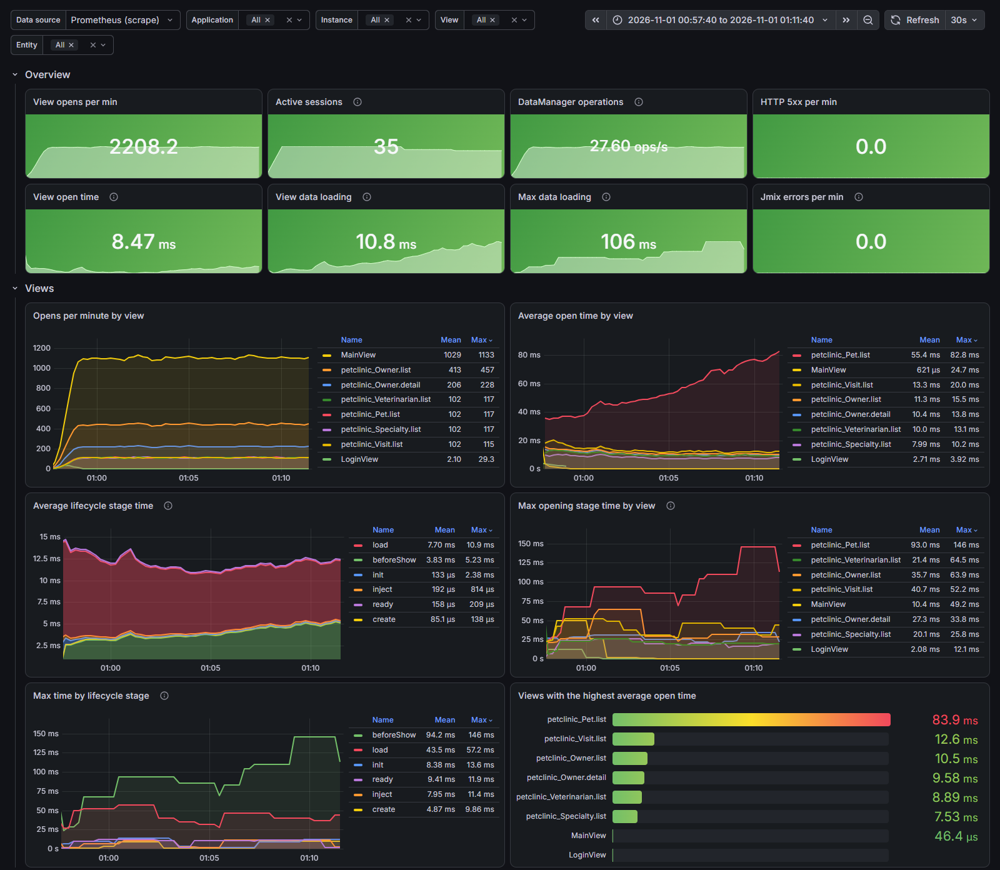
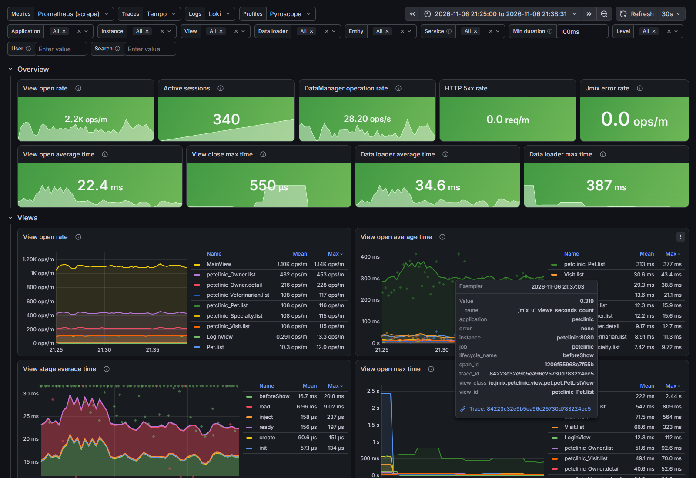
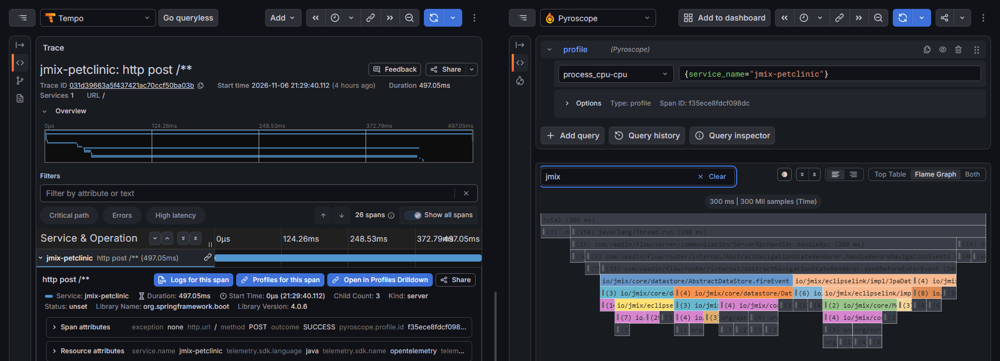
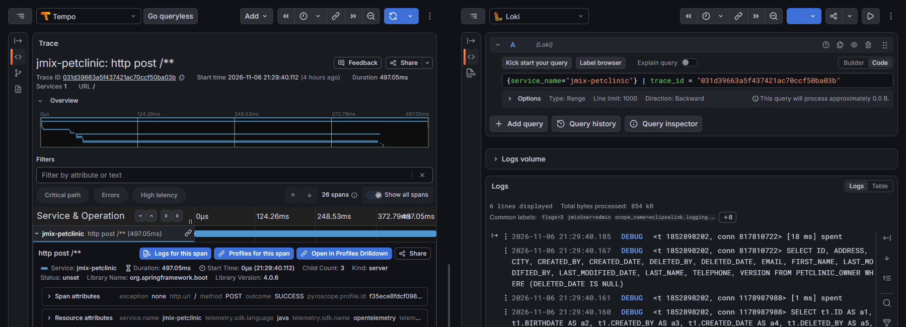
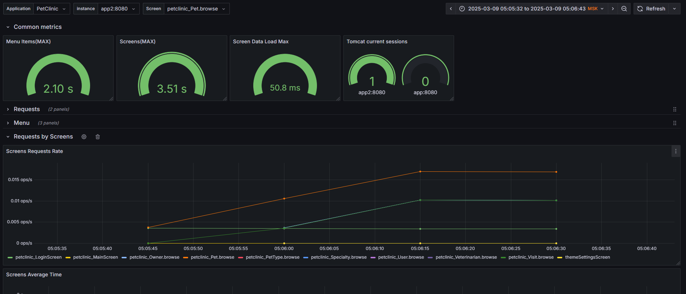
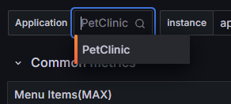

<h1>Jmix Grafana Dashboards</h1>

This repository contains Grafana dashboards for the Micrometer metrics of Jmix applications:
<ul>
    <li><b>Jmix 3 Monitoring</b> for the <b>Jmix 3.0</b> version and later.</li>
    <li><b>Jmix 3 Full Observability</b> for the <b>Jmix 3.0</b> version and later. It shows traces, logs and profiles together with metrics.</li>
    <li>Dashboards for <b>Jmix 1.6.0</b> and <b>Jmix 2.2.0</b> versions and later.</li>
</ul>

<h2>Jmix 3 Monitoring</h2>

The <code>Jmix 3 Monitoring.json</code> dashboard shows the following Jmix 3 metrics: view opening and closing, data loaders and their stages, fragments, UI actions, <code>DataManager</code> loads and saves. It also shows active HTTP sessions, the database connection pool, HTTP requests and the JVM. Durations are shown as average and maximum values, so the dashboard does not require percentiles or histograms. The maximum is the longest single operation in the last few minutes (the Micrometer timer max); it shows rare slow operations that the average hides.

The dashboard can be filtered by application, instance, view, data loader and entity. It deliberately shows more panels than every application needs: remove the panels you do not use in the dashboard edit mode, or collapse a whole row.

The <b>Operations in progress</b> row is based on long task timers, which Micrometer creates for every observation. It shows how many operations have started and not yet finished, and how long the longest of them has been running. An operation that hangs appears there before it completes. If long task timers are disabled with <code>management.metrics.observations.ignored-meters = long-task-timer</code>, the row stays empty.

Jmix 3 records these metrics only if observations are enabled:
```
jmix.ui.ui-observation-enabled = true
jmix.core.data-observation-enabled = true
```
The dashboard uses the metric tags introduced in Jmix 3: <code>view_id</code>, <code>lifecycle_name</code>, <code>loader_id</code> and others. If the application sets <code>jmix.ui.legacy-monitoring-enabled = true</code>, view and data loader metrics are recorded with the Jmix 2 tags; use the Jmix 2.x dashboard for such applications.

Like the other dashboards, it reads metrics from the <code>/actuator/prometheus</code> endpoint (see the settings below) and separates applications by the <code>application</code> tag. When importing the dashboard, select the Prometheus data source.



<h2>Jmix 3 Full Observability</h2>

The <code>Jmix 3 Full Observability.json</code> dashboard shows metrics together with traces, logs and profiles, for example from the Grafana LGTM stack. Its metric rows are the rows of the Jmix 3 Monitoring dashboard, and the duration graphs show exemplars: the tooltip of a point links to the trace of that operation. Three more rows follow:
<ul>
    <li><b>Traces</b>: slow requests, traces with errors, slow view lifecycle stages and slow <code>DataManager</code> loads with the entity name and the JPQL query. The <b>Min duration</b> filter sets the duration threshold.</li>
    <li><b>Logs</b>: log records per minute by level, warnings and errors, and the log with filters by level, user (the <code>jmixUser</code> MDC value) and text.</li>
    <li><b>Profiles</b>: flame graphs of CPU time, memory allocation and lock waiting time.</li>
</ul>

The dashboard reads metrics from a Prometheus that scrapes the <code>/actuator/prometheus</code> endpoint, traces from Tempo, logs from Loki and profiles from Pyroscope. When importing the dashboard, select all four data sources. Metrics are filtered by the <code>application</code> tag, traces, logs and profiles by the OpenTelemetry service name, which is <code>spring.application.name</code> by default.

Exemplars require the following:
<ul>
    <li>Tracing is enabled in the application. The Prometheus registry of Micrometer then attaches trace and span IDs to the timer series. Histograms are not required.</li>
    <li>Prometheus runs with <code>--enable-feature=exemplar-storage</code>.</li>
    <li>The Prometheus data source in Grafana links the <code>trace_id</code> label to the Tempo data source (<b>Exemplars</b> in the data source settings).</li>
</ul>
Metrics exported over OTLP carry no exemplars and no timer maximum, so the dashboard expects the <code>/actuator/prometheus</code> endpoint for metrics. Traces and logs are still sent over OTLP.



The links in the headers of the Traces, Logs and Profiles panels open the Grafana Drilldown apps in a new tab, with the same time range, for the selected service or for all services. In Profiles Drilldown a profile can be exported to pprof or compared with another time range.

The dashboard does not contain the links between signals: they are settings of the Grafana data sources and are not imported with the dashboard.
<ul>
    <li>The <b>Trace</b> link of an exemplar: the Prometheus data source, <b>Exemplars</b>.</li>
    <li><b>Logs for this span</b> in a trace: the Tempo data source, <b>Trace to logs</b>.</li>
    <li><b>Profiles for this span</b> in a trace: the Tempo data source, <b>Trace to profiles</b>.</li>
    <li>The trace link in a log record: the Loki data source, <b>Derived fields</b>.</li>
</ul>

A trace with the CPU profile of its span:



The same trace with the log records of its span:



<h2>Dashboards for Jmix 1.6 and 2.2</h2>

The <code>Jmix 1.x.json</code> dashboard is for the <b>Jmix 1.6.0</b> version and later, the <code>Jmix 2.x.json</code> dashboard is for the <b>Jmix 2.2.0</b> version and later. Both read metrics from a Prometheus data source.



<h2>Base Prometheus Micrometer Settings for Jmix Application</h2>

Add the following libraries:
```
implementation 'org.springframework.boot:spring-boot-starter-actuator'
implementation 'io.micrometer:micrometer-registry-prometheus'
```
Add the following properties to your application:
```
management.endpoints.web.exposure.include=prometheus,health,info,metrics
management.endpoint.health.show-details=always
```
Add the Spring Security configuration

```
@Configuration
public class ActuatorSecurityConfiguration {
    @Bean
    @Order(JmixSecurityFilterChainOrder.FLOWUI - 10)
    public SecurityFilterChain securityFilterChain(HttpSecurity http) throws Exception {
        http.securityMatcher("/actuator/**")
                .authorizeHttpRequests((authorize) -> authorize.requestMatchers("/actuator/**").permitAll());
        return http.build();
    }
}
```

<h2>Application Name and Other Common Tags</h2>
In order to see the application name on the dashboards (especially if you have more than one application), the following application property should be added.

```
management.metrics.tags.application = <YourApplicationName>
```
This tag will be added to all metrics exported with your application. You can also add your own common tags if necessary.



More details about the <b>Spring Boot common tags</b> you can find <a href="https://docs.spring.io/spring-boot/reference/actuator/metrics.html#actuator.metrics.customizing.common-tags">here</a>.

<h2>Percentiles and Histograms</h2>

In addition to the standard set of "Rate/Average Duration/Maximum Duration" metrics, you can export percentile metrics (such as "0.50" and "0.99") with the specific Spring Boot properties. For example, the following property will add percentile metrics for all Jmix metrics.

```
management.metrics.distribution.percentiles.jmix = 0.50,0.95,0.99,0.999
```
Note that you should create your own visualization in your Grafana to visualize such additional metrics.

More details about the <b>Spring Boot per-meter properties</b> you can find <a href="https://docs.spring.io/spring-boot/reference/actuator/metrics.html#actuator.metrics.customizing.per-meter-properties">here</a>. 


